# Redfish Conformance Test Engine — Case Study

> A documentation-only case study of a live-hardware conformance-testing
> framework. No source code, test definitions, or product data are included —
> only the concepts behind the design and the AI-assisted process used to
> build it.

## What is Redfish?

Every data-center server has a **BMC** (Baseboard Management Controller): a
small, separate computer on the motherboard that lets an administrator
manage the server remotely — power it on or off, read temperatures and fan
speeds, update firmware, manage user accounts — even when the main operating
system is down. **OpenBMC** is a widely used open-source firmware stack for
BMCs.

**Redfish** is the industry-standard API for talking to a BMC, published by
the DMTF standards body as the modern replacement for the older IPMI
protocol. It is a RESTful API — JSON over HTTPS — organised as a tree of
resources:

```
/redfish/v1/                 service root
├── Systems/                 the host computer: power state, boot, CPUs, memory
├── Chassis/                 physical enclosure: sensors, fans, power supplies
├── Managers/                the BMC itself: network, logs, reset
├── AccountService/          users and roles
└── UpdateService/           firmware updates
```

Each resource follows a published **schema** that defines its properties. A
client reads with `GET`, changes settings with `PATCH`, creates and deletes
with `POST`/`DELETE`, and triggers operations (such as a reset) by invoking
**actions**. Hardware vendors may add their own **OEM extensions** on top of
the standard schemas, and often publish their own spec saying which
properties their platforms *must* support.

## What it is

Automated conformance testing for a vendor's Redfish implementation on
OpenBMC-based firmware: does the BMC actually implement what the standard
and the vendor's spec require?

The suite covers standard properties, vendor (OEM) extensions, writes, and
actions, across many hardware platforms. Every test runs against **real
hardware** over HTTPS — there is no mock BMC.

## The idea in one paragraph

Tests are **data, not code**. Each Redfish schema gets one declarative YAML
file; a small engine built as a **pytest plugin** turns it into ordinary
pytest tests. Which rig, what that hardware has, and what the spec requires
are kept as three separate layers, so the same test runs unchanged on every
platform. Destructive actions (reboots, firmware updates, key changes) never
run unless explicitly opted into.

## Why it exists

- **Every build, every platform.** Hundreds of checks per firmware build, on
  many platforms, can't be done by hand.
- **The off-the-shelf validators can't answer the question.** DMTF's Service
  Validator is read-only and treats a missing property as legal; the vendor
  spec says properties *must* exist, and some must be *written* and
  *invoked*, not just read.
- **The previous two generations stopped scaling.** An in-house keyword
  runner was hard to maintain; hand-written pytest was hard to scale.

## By the numbers

As of 2026-10-29:

| | |
|---|---|
| Redfish schemas covered | 76 (standard and OEM), in 86 test-definition files across 42 resource areas |
| Test cases | 297 — plus 325 named request variants and 60 multi-step sequences (283 steps) |
| By HTTP method | GET 118 · PATCH 81 · POST 78 · DELETE 19 · PUT 1 |
| Property-compliance files, generated from the specs | 111 |
| Hardware platforms | 12, across 2 hardware generations |
| One platform's run | about 280–650 tests in 5–30 minutes, depending on the hardware |
| Engine features | 19 (see [`DESIGN.md`](DESIGN.md#5-feature-set)) |
| Opt-in risk categories | 13 |
| Engine | 14 modules, ~5,500 lines of Python, covered by 527 self-tests |
| Tickets | 103 of 154 done, across 6 features (see [`AI_WORKFLOW.md`](AI_WORKFLOW.md#7-records)) |

## How it's used (illustrative)

A single CLI wraps pytest, so native pytest options still work:

```bash
python3 run_tests.py --html          # full suite + self-contained HTML report
python3 run_tests.py -m Chassis      # one schema
python3 run_tests.py -k ".GET"       # read-only tests (the id embeds the HTTP method)
python3 run_tests.py --allow-bmc-reset tests/Manager/   # risky action: explicit opt-in
```

## Visualization

Two views: one for the results of a run, one for the design of the tests.
Identifying details (company, rig address, platform names, local paths) and
the run's result counts are masked in these screenshots.

### Results: the HTML report

Each run writes one self-contained HTML page, built on pytest-html. Every
test step is its own row. Rows can be filtered by category, HTTP operation,
and schema, and each row expands to show the request as a replayable curl
command.

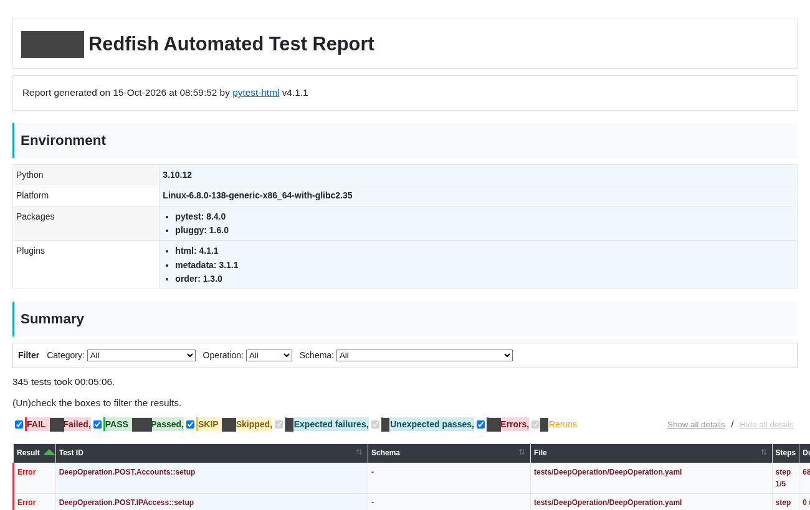

A multi-step sequence shows each step as its own row (`step n/5`):

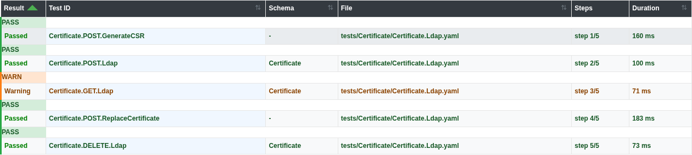

<details>
<summary>More report views: filters, failed, warning, and skipped rows</summary>

Filtered to one category and one operation:

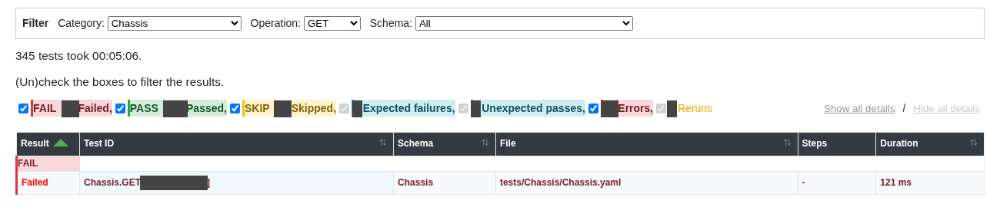

A failed row lists every missing property, not only the first:

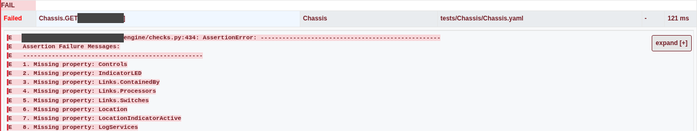

A warning row: the request as curl, and properties the response has but the
schema does not declare:

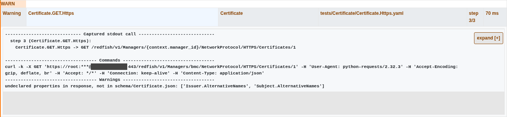

A skipped row: an earlier step in the same sequence failed, so this step was
not sent. The report still shows the curl command it would have sent:

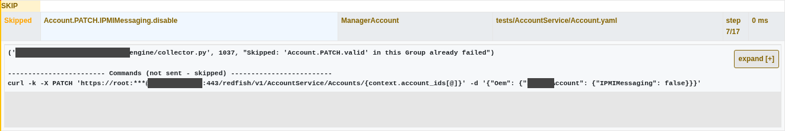

</details>

### Design: the YAML test visualizer

A command reads every test-definition file and writes one HTML page with a
flowchart for each sequence. It reads only the YAML, so it needs no BMC.

- Blue boxes are requests, green boxes are Python helper steps, and yellow
  boxes are static inputs.
- Grey edges show step order. Orange edges show which values pass from one
  step to the next.
- A sidebar lists the sequences by resource area and file.

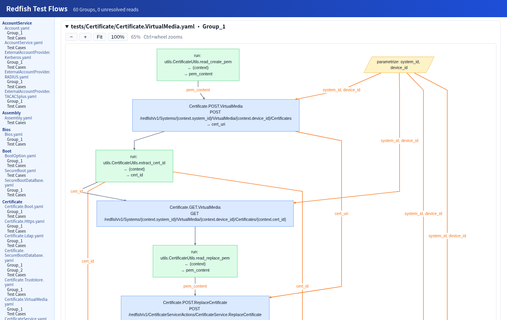

A step that reads a value that no earlier step writes is flagged before any
run on hardware. Here, a typo in a key name:

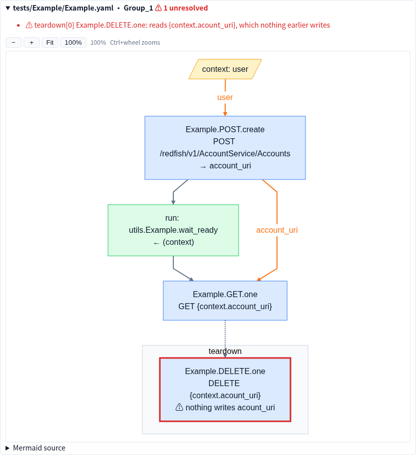

<details>
<summary>More visualizer views: test-case list, test-case diagram, Mermaid source</summary>

Each file's test cases and their named request variants:

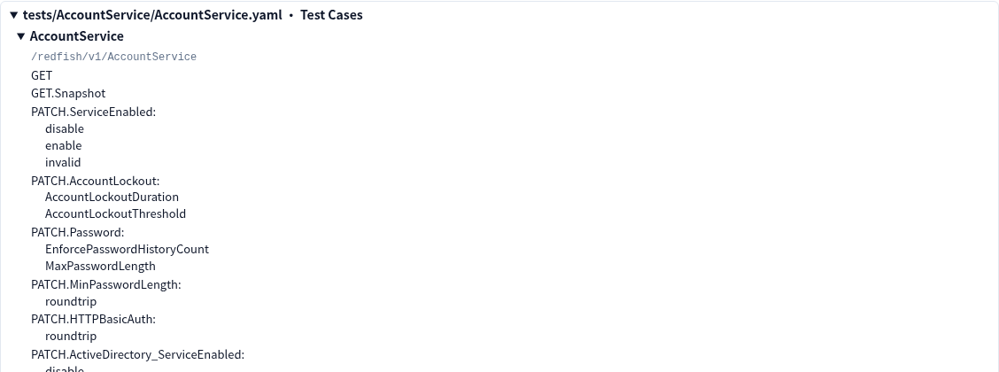

A single test case with its own setup steps:

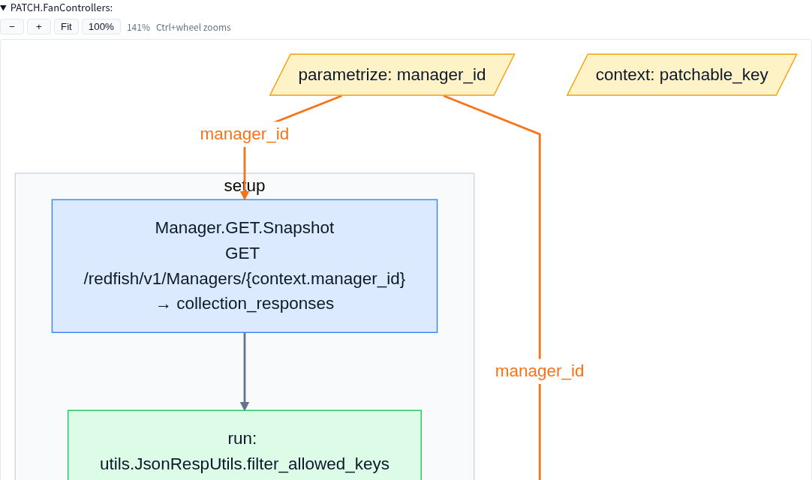

Each diagram's Mermaid source can be copied into a code review or a wiki:

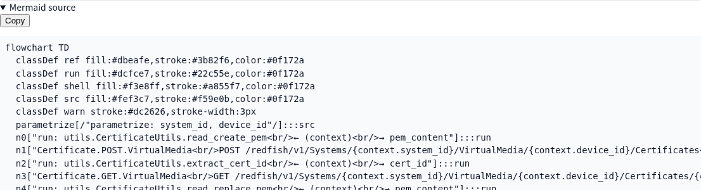

</details>

## Read next

- **[`PROJECT.html`](https://htmlpreview.github.io/?https://github.com/JohnBlue-git/RedfishAutoYamlTestInterview/blob/main/PROJECT.html)**
  — the whole case study as one visual page (open in a browser).
- **[`DESIGN.md`](DESIGN.md)** — the architecture and the key design
  concepts, and why it took this shape.
- **[`AI_WORKFLOW.md`](AI_WORKFLOW.md)** — how it was built with an AI: the
  grill → spec → tickets → implement loop, and the gates that keep
  AI-written changes safe on shared hardware.
